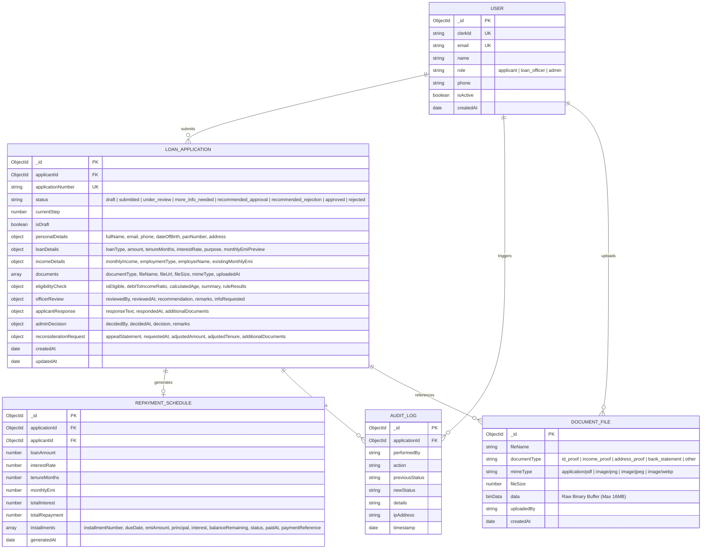
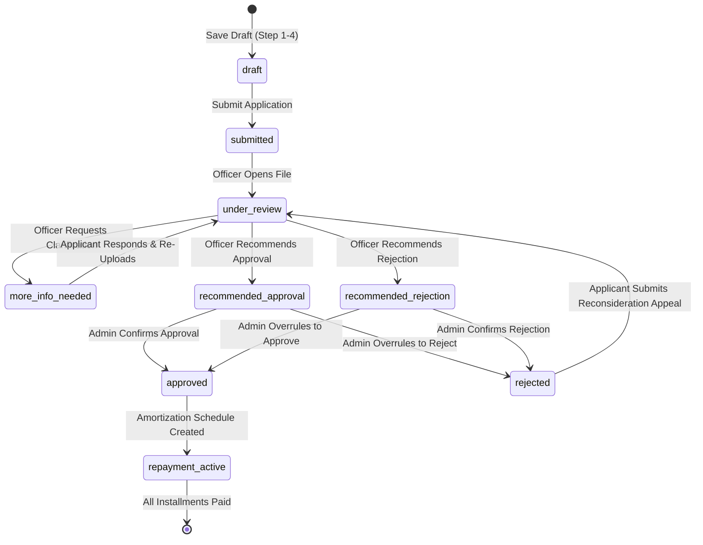

# Correm Advisory — Loan Management System (LMS)

> **Author**: **Kushal Patel**  
> **Platform**: Enterprise Loan Origination & Lifecycle Management  
> **Tech Stack**: React 19, Vite, Node.js, Express, MongoDB Atlas, Clerk Auth

A robust, enterprise-grade Loan Origination and Lifecycle Management Platform built with React, Vite, Node.js, Express, and MongoDB Atlas. Features deterministic credit underwriting, role-based governance (Applicant, Loan Officer, Admin), in-memory binary document storage, and automated EMI repayment schedule generation.

---

## Table of Contents

- [Overview & Architecture](#overview--architecture)
- [Setup Instructions](#setup-instructions)
  - [Prerequisites](#prerequisites)
  - [Environment Variables](#environment-variables)
  - [Running the Backend](#running-the-backend)
  - [Running the Frontend](#running-the-frontend)
  - [Database Setup & Seeding](#database-setup--seeding)
  - [Vercel Deployment Guide](#vercel-deployment-guide)
- [Database Schema & ER Diagram](#database-schema--er-diagram)
  - [Mermaid ER Diagram](#mermaid-er-diagram)
  - [Entity Schema Breakdown](#entity-schema-breakdown)
- [Eligibility-Check Rules Engine](#eligibility-check-rules-engine)
  - [Core Underwriting Rules](#core-underwriting-rules)
  - [Mathematical Formulas](#mathematical-formulas)
- [Loan Workflow & State Machine](#loan-workflow--state-machine)
- [Known Limitations & Future Roadmap](#known-limitations--future-roadmap)

---

## Overview & Architecture

The system implements a four-party loan lifecycle:

```
[ Applicant ] ---> Multi-Step Application & MongoDB Document Upload
      │
      ▼
[ Loan Officer ] ---> Deterministic Credit Policy Engine & Verification
      │
      ├── (Request Clarification / More Info) ---> [ Applicant Re-Uploads ]
      ▼
[ Admin ] ---> Final Review, Underwriting Approval / Rejection
      │
      ├── Approved ---> Automated Reducing-Balance Repayment Schedule
      └── Rejected ---> [ Applicant Reconsideration & Appeal Flow ]
```

### Key Architectural Highlights
- **Binary Document Storage in MongoDB**: Eliminates external third-party CDN ACL gates. File uploads are buffered into memory via `multer.memoryStorage()` and stored directly in a dedicated `DocumentFile` MongoDB collection, streamed to browser `<iframe>` and `` tags via `GET /api/v1/applications/document/:id`.
- **Deterministic Underwriting Engine**: Rule-based credit policy checks run in milliseconds, evaluating age limits, category-specific income benchmarks, reducing-balance debt commitments, and document presence.
- **Microservice-Ready Split Deployment**: Configured with Vercel Serverless Functions (`backend/api/index.js`) and Vite SPA rewrites (`frontend/vercel.json`), with CORS origins allowlisted.

---

## Setup Instructions

### Prerequisites
- **Node.js**: v18.0.0 or higher (v20+ recommended)
- **npm** or **pnpm**
- **MongoDB Atlas** account or local MongoDB instance (v6.0+)
- **Clerk Authentication** account (for authentication and role provisioning)

---

### Environment Variables

#### Backend Configuration (`backend/.env`)

| Variable | Description | Example / Default Value |
| :--- | :--- | :--- |
| `PORT` | Local server listening port | `5000` |
| `MONGODB_URI` | MongoDB Atlas or local connection URI | `mongodb+srv://<user>:<password>@cluster0.codbn57.mongodb.net` |
| `ADMIN_TOKEN` | Secret token to unlock Administrator role | `12345` |
| `CLERK_PUBLISHABLE_KEY` | Clerk authentication publishable key | `pk_test_...` |
| `CLERK_SECRET_KEY` | Clerk backend secret key (optional for token verify) | `sk_test_...` |
| `FRONTEND_URL` | Frontend client origin for CORS allowlisting | `https://frontend-xi-steel-92.vercel.app` |
| `CLIENT_URL` | Alternate frontend origin fallback | `http://localhost:5173` |
| `BACKEND_URL` | Canonical backend base URL for file streaming links | `https://loan-mangement-system.vercel.app` |

#### Frontend Configuration (`frontend/.env`)

| Variable | Description | Example / Default Value |
| :--- | :--- | :--- |
| `VITE_CLERK_PUBLISHABLE_KEY`| Client-side Clerk publishable key | `pk_test_...` |
| `ADMIN_TOKEN` | Admin passkey for local demo role unlock | `12345` |
| `VITE_API_URL` | Backend API base path | `https://loan-mangement-system.vercel.app/api/v1` (or `/api/v1` locally) |
| `VITE_BACKEND_URL` | Backend host origin for document previews | `https://loan-mangement-system.vercel.app` |
| `VITE_FRONTEND_URL` | Public frontend client URL | `https://frontend-xi-steel-92.vercel.app` |

---

### Running the Backend

1. Navigate to the backend directory:
   ```bash
   cd backend
   ```
2. Install dependencies:
   ```bash
   npm install
   ```
3. Start the server:
   - **Development mode (with auto-reload via nodemon)**:
     ```bash
     npm run dev
     ```
   - **Production mode**:
     ```bash
     npm start
     ```
4. Verify backend health:
   ```bash
   curl http://localhost:5000/api/v1/health
   # Returns: {"success":true,"message":"Correm LMS API is operational","version":"1.0.0"}
   ```

---

### Running the Frontend

1. Navigate to the frontend directory:
   ```bash
   cd frontend
   ```
2. Install dependencies:
   ```bash
   npm install
   ```
3. Start the Vite development server:
   ```bash
   npm run dev
   ```
4. Open your browser and navigate to `http://localhost:5173`.
   - The Vite development server automatically proxies `/api` requests to `http://localhost:5000`.

---

### Database Setup & Seeding

1. **MongoDB Connection**:
   The backend connects to MongoDB via Mongoose. If running locally, ensure your local MongoDB daemon is active (`mongod`). If using MongoDB Atlas, verify your IP address is allowlisted under **Network Access** in the Atlas Console.
2. **Auto-Initialization**:
   Mongoose automatically registers collections and indexes on first startup (`users`, `loanapplications`, `documentfiles`, `repaymentschedules`, `auditlogs`).
3. **Connection Pooling**:
   [backend/config/db.js](file:///c:/Users/Kushal%20Patel/Desktop/New%20folder/Loan-Mangement-System/backend/config/db.js) caches existing connections via `mongoose.connection.readyState >= 1` to prevent connection exhaustion in serverless environments.

---

### Vercel Deployment Guide

To deploy the system to Vercel without creating external folders:

1. **Deploy Backend (`loan-mangement-system.vercel.app`)**:
   - **Root Directory**: `backend`
   - **Framework Preset**: `Other`
   - **Environment Variables**: Add `MONGODB_URI`, `ADMIN_TOKEN`, `CLERK_PUBLISHABLE_KEY`, `FRONTEND_URL`, `CLIENT_URL`, `BACKEND_URL`.
   - Entry point is automatically routed via [backend/vercel.json](file:///c:/Users/Kushal%20Patel/Desktop/New%20folder/Loan-Mangement-System/backend/vercel.json) to [backend/api/index.js](file:///c:/Users/Kushal%20Patel/Desktop/New%20folder/Loan-Mangement-System/backend/api/index.js).

2. **Deploy Frontend (`frontend-xi-steel-92.vercel.app`)**:
   - **Root Directory**: `frontend`
   - **Framework Preset**: `Vite`
   - **Environment Variables**: Add `VITE_CLERK_PUBLISHABLE_KEY`, `ADMIN_TOKEN`, `VITE_API_URL`, `VITE_BACKEND_URL`, `VITE_FRONTEND_URL`.
   - Client-side routing and reverse-proxy fallbacks are handled by [frontend/vercel.json](file:///c:/Users/Kushal%20Patel/Desktop/New%20folder/Loan-Mangement-System/frontend/vercel.json).

---

## Database Schema & ER Diagram

### Mermaid ER Diagram



---

### Entity Schema Breakdown

#### 1. `User` ([backend/models/User.js](file:///c:/Users/Kushal%20Patel/Desktop/New%20folder/Loan-Mangement-System/backend/models/User.js))
Manages system actors and role authorization:
- `clerkId`: External unique identifier synced from Clerk authentication.
- `role`: Role enum (`applicant`, `loan_officer`, `admin`) enforced by `requireRole` middleware.
- `email`: Indexed and lowercased email for applicant scoping.

#### 2. `LoanApplication` ([backend/models/LoanApplication.js](file:///c:/Users/Kushal%20Patel/Desktop/New%20folder/Loan-Mangement-System/backend/models/LoanApplication.js))
Central state entity tracking multi-step applications from draft through disbursement or rejection:
- `personalDetails`: KYC data including PAN, date of birth (used for age evaluation), contact information.
- `loanDetails`: Requested amount, tenure in months, annual interest rate, loan product type (`personal`, `vehicle`, `home`, `business`).
- `incomeDetails`: Declared monthly salary/revenue, employer info, existing EMI obligations (used for DTI).
- Embedded subdocuments:
  - `eligibilityCheck`: Audit record of automated underwriting checks.
  - `officerReview`: Recommendation and clarification requests.
  - `applicantResponse`: Applicant notes and re-uploaded documents in response to officer inquiries.
  - `adminDecision`: Final sign-off record.
  - `reconsiderationRequest`: Appeal statement, adjusted tenure/principal, and appeal proofs for rejected loans.

#### 3. `DocumentFile` ([backend/models/DocumentFile.js](file:///c:/Users/Kushal%20Patel/Desktop/New%20folder/Loan-Mangement-System/backend/models/DocumentFile.js))
Dedicated binary storage collection replacing third-party CDNs:
- `data`: Binary Buffer storing raw document bytes (up to 10MB per file).
- `mimeType`: Standard MIME type (`application/pdf`, `image/png`, `image/jpeg`).
- Streamed directly via `res.setHeader('Content-Type', doc.mimeType); res.send(doc.data)` to render inline across browsers with zero authentication barriers.

#### 4. `RepaymentSchedule` ([backend/models/RepaymentSchedule.js](file:///c:/Users/Kushal%20Patel/Desktop/New%20folder/Loan-Mangement-System/backend/models/RepaymentSchedule.js))
Amortization schedule generated automatically upon Admin approval:
- Tracks month-by-month principal vs. interest components using the standard reducing-balance formula.
- Each installment tracks status (`pending`, `paid`, `overdue`), payment timestamp, and transaction reference.

---

## Eligibility-Check Rules Engine

The underwriting module ([backend/controllers/reviewController.js](file:///c:/Users/Kushal%20Patel/Desktop/New%20folder/Loan-Mangement-System/backend/controllers/reviewController.js) & [backend/utils/eligibilityEngine.js](file:///c:/Users/Kushal%20Patel/Desktop/New%20folder/Loan-Mangement-System/backend/utils/eligibilityEngine.js)) implements deterministic, rule-based credit policy checks.

### Core Underwriting Rules

| Rule Name | Benchmark / Threshold | Evaluation Logic | Failure Consequence |
| :--- | :--- | :--- | :--- |
| **1. Age Check** | **21 to 65 Years** | Evaluated dynamically from `personalDetails.dateOfBirth`: <br>`age = floor((now - DOB) / 365.25 days)`. | Flagged as ineligible if applicant is $<21$ or $>65$ years old. |
| **2. Minimum Monthly Income** | **Category-Specific**: <br>• Personal: **₹25,000**<br>• Vehicle: **₹30,000**<br>• Home: **₹40,000**<br>• Business: **₹50,000** | Compares declared `incomeDetails.monthlyIncome` against the minimum benchmark for `loanDetails.loanType`. | Flagged as below income capacity for the selected loan category. |
| **3. Debt-to-Income (DTI) Ratio** | **$\le 50.0\%$** | Sums current monthly obligations plus proposed loan EMI, divided by gross monthly income. | Flagged if total debt commitments exceed $50\%$ of monthly income. |
| **4. Mandatory Document Verification** | **ID Proof + Income Proof** | Scans uploaded application documents for both `id_proof` and `income_proof` document types. | Flagged if either mandatory verification proof is missing. |

---

### Mathematical Formulas

#### 1. Equated Monthly Installment (EMI) — Reducing Balance
The monthly EMI is calculated using the reducing-balance amortization formula:

$$EMI = \frac{P \times r \times (1 + r)^n}{(1 + r)^n - 1}$$

Where:
- $P$ = Principal loan amount requested
- $r$ = Monthly interest rate $= \frac{\text{Annual Rate}}{12 \times 100}$
- $n$ = Loan tenure in months

#### 2. Debt-to-Income (DTI) Ratio
Assesses borrower leverage and debt repayment capacity:

$$\text{DTI Ratio (\%)} = \left( \frac{\text{Existing Monthly EMI} + \text{Proposed Loan EMI}}{\text{Declared Monthly Income}} \right) \times 100$$

- **Safe Threshold**: $\text{DTI} \le 50.0\%$ (passes automated credit policy).
- **Excessive Leverage**: $\text{DTI} > 50.0\%$ (requires officer review or term adjustment).

---

## Loan Workflow & State Machine



---

## Known Limitations & Future Roadmap

While the application is fully functional for end-to-end loan workflows, the following areas represent natural extensions for an enterprise production deployment:

### 1. Document Extraction & OCR
- **Current State**: Documents are validated by metadata, MIME type, and binary presence in MongoDB.
- **Next Steps**: Integrate Google Cloud Document AI or AWS Textract to automatically extract PAN numbers, names, and annual income from Form 16 / ITR PDFs to cross-verify against applicant-typed fields.

### 2. Credit Bureau Integration (CIBIL / Experian)
- **Current State**: Uses self-reported existing EMIs to calculate Debt-to-Income (DTI) ratio.
- **Next Steps**: Integrate direct Credit Bureau APIs (CIBIL / CRIF High Mark) to pull real-time credit score, active liabilities, and repayment history automatically on submission.

### 3. Real-Time Webhooks & Push Notifications
- **Current State**: Status synchronization occurs through reactive REST polling and dashboard re-renders.
- **Next Steps**: Introduce WebSockets or Server-Sent Events (SSE) to notify applicants immediately when a loan officer requests clarification or an admin reaches a decision.

### 4. Enterprise File Storage (> 16MB)
- **Current State**: Files are stored as BSON Buffers in MongoDB `DocumentFile` (capped at 10MB per file, well within MongoDB's 16MB document limit).
- **Next Steps**: Migrate to MongoDB GridFS or private S3 buckets with signed expiring URLs if multi-volume commercial loan dossiers (> 50MB) are required.

### 5. Payment Gateway Integration
- **Current State**: Repayment schedule installments are updated through simulation actions in the UI.
- **Next Steps**: Integrate Razorpay or Stripe recurring mandates (e-NACH) for automated monthly debit of approved EMI installments.

---

## Author

**Kushal Patel**  
Full-Stack Software Engineer & System Architect  
- **Project**: Correm Advisory Loan Management System (LMS)
- **Frontend Live URL**: [https://frontend-xi-steel-92.vercel.app](https://frontend-xi-steel-92.vercel.app)
- **Backend Live URL**: [https://loan-mangement-system.vercel.app](https://loan-mangement-system.vercel.app)

